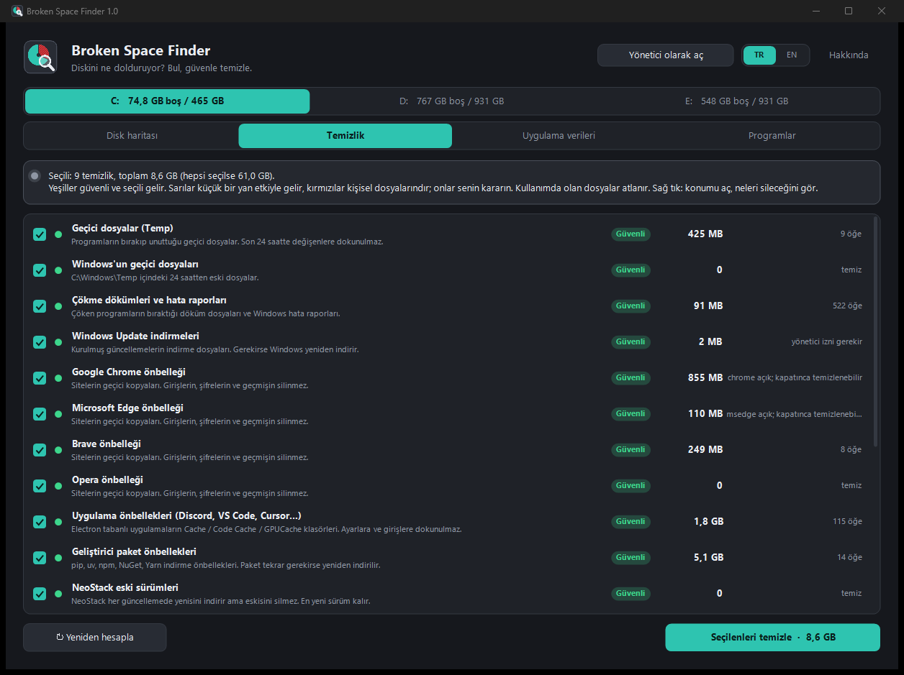
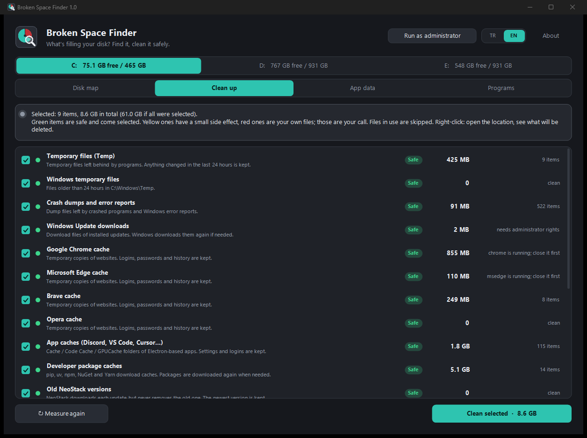

<h1 align="center">Broken Space Finder</h1>

<b>Diskini ne dolduruyor? Bul, güvenle temizle.</b> 
Hiçbir şey indirmediğin hâlde SSD'nin neden sürekli dolduğunu gösterir: en büyük klasörler ve dosyalar, sınırsız büyüyen önbellekler, kaldırılmış programlardan kalan veriler ve aylardır açmadığın programlar.

<a href="#english">English</a> · <a href="https://github.com/HErkanuzun/BrokenSpaceFinder/releases/latest">İndir / Download</a> · <a href="CHANGELOG.md">Sürüm geçmişi</a>

> ⚠️ **Kalıcı silinen şeyler geri getirilemez.** Program Windows'un ve kurulu programların klasörlerini silmeni engeller, güvenli olmayan her şey için ayrıca onay ister. Yine de emin olmadığın bir şeyi silmeden önce sağ tıklayıp **Explorer'da göster** ile içine bak.

## Broken ailesi

Windows'ta bozuk ya da sorunlu bir şeyi bulup onunla yaşamanı sağlayan küçük araçlar. Hepsi aynı tasarım dilinde, ücretsiz ve açık kaynak.

| | |
|---|---|
| [Broken Screen Resizer](https://github.com/HErkanuzun/BrokenScreenResizer) | Monitörün bozuk kısmını Windows'un dışında bırakır. |
| [Broken Disk Resizer](https://github.com/HErkanuzun/BrokenDiskResizer) | Hard diskin bozuk sektörlerini bulur, sadece sağlam kısımları bölümler. |
| **Broken Space Finder** | Diski neyin doldurduğunu bulur ve güvenle temizler. |
| [Broken Microphone](https://github.com/HErkanuzun/BrokenMicrophone) | Telefonu ya da tableti bilgisayarın mikrofonu yapar. |
| [Broken Hub](https://github.com/HErkanuzun/BrokenHub) | Bütün Broken araçlarını tek yerden kurar, günceller ve açar. |

## Kurulum

1. [Son sürümden](https://github.com/HErkanuzun/BrokenSpaceFinder/releases/latest) `BrokenSpaceFinder-1.0-Setup.exe`'yi indir ve çalıştır.
2. Başlat menüsünden **Broken Space Finder**'ı aç. Normal kullanıcı olarak açılır; yönetici izni sadece gerektiğinde, uygulamanın içinden istenir.

Kurulum istemiyorsan `Portable.zip`'i aç, içindeki exe'yi çalıştır.

> Exe imzalı olmadığı için Windows SmartScreen ilk açılışta "Windows bilgisayarınızı korudu" diyebilir: **Ek bilgi → Yine de çalıştır**.

## Nasıl kullanılır

Üstte sürücüyü seç, sonra dört sekmeden birine geç (**Ctrl+1…4**).

1. **Disk haritası.** **Diski tara** sürücüdeki bütün klasörleri ölçer (500 GB'lık bir SSD 15–50 saniye; diske hiçbir şey yazılmaz). Klasörler büyükten küçüğe sıralanır, renkli çubuk bu klasörün neyle dolduğunu gösterir. Çift tıklayıp içine gir, **Geri** tuşuyla dön. Sağda sürücüdeki en büyük 300 dosya listelenir: unutulmuş ekran kayıtları, kurulum dosyaları, sanal diskler…
2. **Temizlik.** Diski sessizce dolduran önbellekleri ve geçici dosyaları ölçer. Her seçeneğin risk etiketi vardır:
   - 🟢 **Güvenli** (seçili gelir): Temp, çökme dökümleri, Windows Update indirmeleri, tarayıcı ve uygulama önbellekleri, pip/uv/npm/NuGet önbellekleri, NeoStack'in eski sürümleri, Unreal çökme raporları ve log'ları.
   - 🟡 **Küçük yan etki**: ekran kartı shader önbellekleri (ilk açılışta kısa takılma), Unreal önbellekleri (shader'lar yeniden derlenir), Geri Dönüşüm Kutusu, hazırda bekletme dosyası.
   - 🔴 **Dikkat** (kişisel dosyaların): NVIDIA ekran kayıtları, İndirilenler'deki 90 günden eski dosyalar.

   Program açıksa (ör. Chrome ya da Unreal) o seçenek atlanır ve nedeni yazılır. Sağ tık → **Neleri silecek?** silinecekleri tek tek gösterir.
3. **Uygulama verileri.** AppData'daki ve kullanıcı klasöründeki (`.cache`, `.nuget`…) her klasörün boyutunu ve içindeki en yeni dosyanın tarihini gösterir. 90 günden uzun süredir hiç değişmeyenler işaretlenir; çoğu kaldırılmış programlardan kalmadır. Windows'a ait klasörler gri görünür ve silinemez.
4. **Programlar.** Kurulu her programın boyutunu ve en son ne zaman açıldığını gösterir (Windows'un kendi kayıtlarından: UserAssist ve Prefetch). **Kaldır…** programın kendi kaldırma aracını açar.

## Neden diskim doluyor?

Bu aracı yazdıran gerçek durumdan, 500 GB'lık bir SSD'de bulunanlar:

| Ne | Boyut | Neden |
|---|---|---|
| NVIDIA shader önbelleği | 25 GB | Sınırsız; Unreal her shader derledikçe büyür. |
| NeoStack eski sürümleri | 23 GB | Her güncellemede yenisini indirip eskisini silmiyordu (6 haftada 33 sürüm). |
| Unreal ortak önbelleği | 22 GB | Bütün projelerin derlenmiş shader'ları. |
| Yanlışlıkla başlayan ekran kaydı | 15 GB | Alt+F9 ile tek gecede. |
| Temp | 15 GB | Programların bırakıp unuttuğu dosyalar. |

## Korumalar

| | |
|---|---|
| **Sistem klasörleri** | Windows klasörü, Program Files, sistem alanları, `pagefile.sys`/`hiberfil.sys`, AppData'daki Microsoft klasörleri ve ana klasörlerin kendisi (Kullanıcılar, Belgeler, İndirilenler…) elle silinemez. |
| **Onay** | Her silme önce ne silineceğini ve boyutunu gösterir. Kalıcı silme ve kişisel dosyalar için `SİL` yazman gerekir. |
| **Kullanımdaki dosyalar** | Atlanır, sayısı raporlanır. Açık bir programın önbelleği hiç denenmez. |
| **Bağlantı klasörleri** | Junction/symlink'lerin içine girilmez; silinirse sadece bağlantı kalkar, hedefine dokunulmaz. |
| **Unreal Autosaves** | Hiçbir seçenek dokunmaz. |

## Kaynaktan derleme

Ek bir araç gerekmez; Windows'un kendi .NET Framework 4 derleyicisi kullanılır.

| Dosya | Ne yapar |
|---|---|
| `build.bat` | Sadece programı derler → `bin\BrokenSpaceFinder.exe` |
| `paketle.bat` | Programı derler, Inno Setup yoksa `winget` ile kurar, `dist\` klasörüne **Setup.exe**, **Portable.zip** ve **SHA256SUMS.txt** üretir |
| `scripts\make-icon.ps1` | Logoyu ve simgeyi yeniden çizer |

GitHub'a `v1.0` gibi bir etiket gönderildiğinde aynı paketler Actions ile derlenip sürüm olarak yayımlanır.

Ayarlar `%AppData%\BrokenSpaceFinder` klasöründe tutulur.

## Sınırlar

- Yönetici olmadan Windows'un bazı korunan klasörleri ölçülemez; özet bu farkı "hiçbir klasörde görünmedi" diye gösterir. Sistem geri yükleme noktaları hiçbir klasörde görünmez.
- Epic Games Launcher'ın kurduğu Unreal Engine sürümleri ve Steam oyunları "Programlar" listesinde çıkmayabilir; disk haritasında görünürler.
- Son kullanım tarihi tahmindir: Başlat menüsünden ya da masaüstünden açılan programlarda doğrudur.
- Windows 10 ve üstü gerekir.

---

## English

**Broken Space Finder** shows why your SSD keeps filling up even though you don't download anything: the biggest folders and files, caches that grow without limit, data left behind by removed programs and programs you haven't opened for months. Then it cleans up safely.

> ⚠️ Things deleted permanently can't be restored. The app refuses to delete Windows and installed programs' folders and asks for confirmation for anything that isn't safe. Still, before deleting something you're not sure about, right-click and use **Show in Explorer** to look inside.

**Install:** download `BrokenSpaceFinder-1.0-Setup.exe` from the [latest release](https://github.com/HErkanuzun/BrokenSpaceFinder/releases/latest) (or use the portable ZIP). The app runs as a normal user and asks for administrator rights only when needed.

**Use:** pick the drive, then one of the four tabs (**Ctrl+1…4**):

1. **Disk map** – measures every folder on the drive (15–50 seconds for a 500 GB SSD; nothing is written). Double-click to go inside, Backspace to go back. The 300 largest files are listed on the right.
2. **Clean up** – temporary files and caches, each with a risk label: 🟢 *Safe* (selected by default), 🟡 *Minor side effect*, 🔴 *Careful* (your own files). Items whose program is running are skipped. Right-click → *What will be deleted?* lists everything first.
3. **App data** – every folder in AppData and your home folder with its size and the date of its newest file. Folders unchanged for 90+ days are flagged; most are left over from removed programs.
4. **Programs** – each installed program's size and when it was last opened (from Windows' UserAssist and Prefetch records). *Uninstall…* starts the program's own uninstaller.

**Safety:** Windows, Program Files, system areas, `pagefile.sys`/`hiberfil.sys`, Microsoft data in AppData and the main user folders themselves can't be deleted by hand. Every delete shows what and how much first; permanent deletes and your own files require typing `DELETE`. Files in use are skipped. Junctions are never followed. Unreal Autosaves are never touched. See [SECURITY.md](SECURITY.md) for everything the app does on your computer.

**Build:** `build.bat` builds the exe with the .NET Framework compiler that ships with Windows. `paketle.bat` also builds the installer, portable ZIP and checksums.

**The Broken family:** [Broken Screen Resizer](https://github.com/HErkanuzun/BrokenScreenResizer) (keeps a monitor's broken area out of use) · [Broken Disk Resizer](https://github.com/HErkanuzun/BrokenDiskResizer) (keeps a disk's bad sectors out of use) · **Broken Space Finder** · [Broken Microphone](https://github.com/HErkanuzun/BrokenMicrophone) (turns a phone or tablet into the computer's microphone) · [Broken Hub](https://github.com/HErkanuzun/BrokenHub) (installs, updates and opens all the Broken tools from one place).

**[Code signing policy](SECURITY.md#code-signing-policy)** · Free code signing by SignPath Foundation · Kod imzalama politikası

MIT License.
